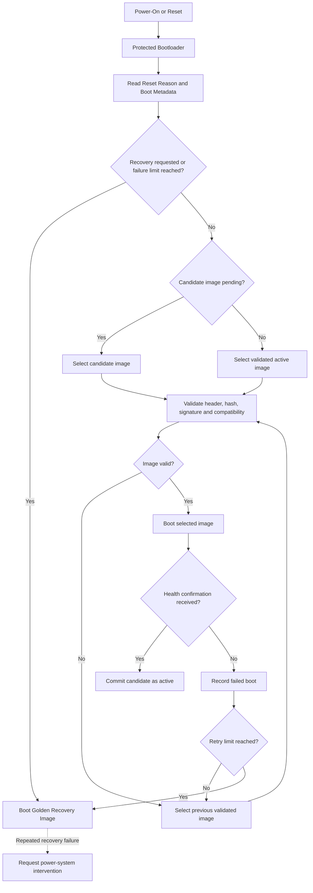

### 1.4 Boot and OTA Firmware Update as Core Architecture

Firmware Update over the Air, or OTA FWU, is treated as a core part of the flight architecture. This is particularly important when software development continues close to a fixed launch date.

The boot and update architecture must tolerate:

- Interrupted uploads
- Corrupted files
- Invalid configurations
- Incompatible software
- Failed startup
- Repeated watchdog resets
- An image that boots but does not operate correctly

The baseline therefore includes:

- A protected bootloader
- Signed software images
- Image-integrity validation
- Persistent reset and boot metadata
- A Golden Recovery Image
- A/B operational images when storage permits
- Automatic rollback
- Cooperation with the hardware watchdog and power system

The bootloader should be small and changed only when strictly necessary. 

Its main responsibilities are:

1. Read the reset reason and persistent boot metadata.
2. Select the image to execute.
3. Validate the selected image header, integrity and signature.
4. Start the selected image.
5. Fall back to another image after repeated boot failures, either B or Golden.

The communication, file-transfer and repair functionality belongs in a separate Golden Recovery Image. The recovery image contains the minimum software required to:

- Communicate with ground through at least the contingency link
- Access the interfaces required for spacecraft safing and recovery
- Read reset and boot information
- Access non-volatile storage
- Receive a replacement software image
- Validate an uploaded image
- Select the image for the next boot
- Restore a known configuration
- Reboot the OBC

The recovery image does not need to execute nominal payload operations or the complete AOCS implementation. It may contain only the minimum control required to keep the spacecraft safe and recoverable.

If sufficient non-volatile memory is available, the preferred layout is:

```text
Protected Bootloader
Golden Recovery Image
Operational Image A
Operational Image B
Persistent Boot Metadata
Configuration and Mission Storage
```

In this configuration, one operational slot remains validated while the other receives the candidate image. The previous operational image is preserved until the new image confirms that it is healthy.


In the reduced layout, the Golden image provides the recovery path. The system does not retain two complete operational releases.

Software transfer should be block-based and resumable. 

A complete CFDP or file-transfer implementation may be used (from CFE) , but a smaller mission-specific protocol is also acceptable if it supports:

- Per-block integrity checking
- Resume after loss of contact
- Final complete-image verification

After reception, the complete image is checked using:

- Cryptographic hash
- Entry point and memory limits

A commit identifier can be stored as build metadata, and a fast checksum such as xxHash may be useful during development or block handling. 

The image is first marked as a candidate. After reboot, it must complete a health-confirmation sequence before it is committed as the active image. Reaching `main()` or starting the FreeRTOS scheduler is not enough.

Health confirmation should require, at minimum:

- Successful cFE core initialisation
- Running Mode Manager
- Running Health Monitor
- Stable execution for a defined period
-

If the candidate does not confirm itself before a defined timeout, or if it causes repeated watchdog resets, the bootloader selects the previous validated image or the Golden Recovery Image.



This protected-bootloader, candidate-image and confirmation pattern is also used in common embedded update systems such as MCUboot and FreeRTOS OTA implementations. The details must still be adapted to the selected processor, flash technology and spacecraft operations concept.

> [!assumption] Platform  
> The OBC uses a flight-capable single-core embedded processor with hardware timers, an independent watchdog, non-volatile memory and standard spacecraft interfaces.

> [!assumption] Application loading  
> The first FreeRTOS flight configuration uses statically linked applications or a controlled static application registry. Runtime ELF loading is not required for the initial baseline.

> [!assumption] Memory protection  
> ECC-protected RAM and non-volatile storage are preferred where supported by the processor and memory technology. Software checks can provide additional corruption detection, but they are not equivalent to hardware ECC and consume CPU and memory resources.

> [!assumption] Communications  
> A robust low-rate radio link is available for nominal operations and contingency access. A higher-rate link may be available for payload data, detailed logs and software transfer. The high-rate link may require more accurate pointing, while the low-rate link should remain available in degraded or safe modes.

> [!assumption] Propulsion  
> The propulsion system provides a command-and-telemetry interface through a dedicated controller or interface electronics. The OBC performs mission-level FDIR and recovery coordination, while immediate actuator-level failures and shutdown actions are handled and logged locally by the propulsion controller.

> [!assumption] Recovery  
> The power subsystem can detect repeated resets or missed watchdog servicing and can support escalation to a recovery boot mode. This may be performed autonomously or through a ground-commanded OBC power cycle.

---
