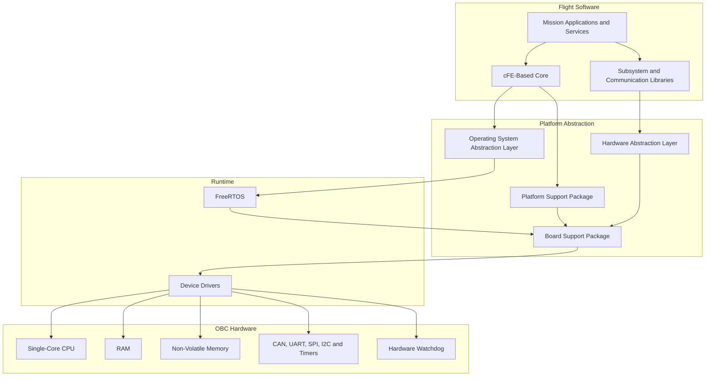
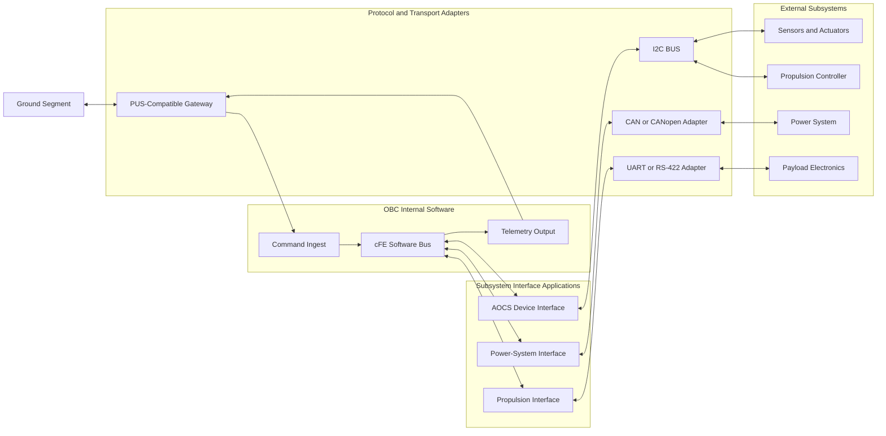

### 2.1 Layered Architecture

The diagram is logical rather than hardware-specific. The Propulsion Interface may use CSP over CAN in one implementation and a direct UART or CAN protocol in another. The Propulsion Application remains unchanged because the transport and protocol implementation are hidden below the Software Bus interface.

From a CDH point of view : 

