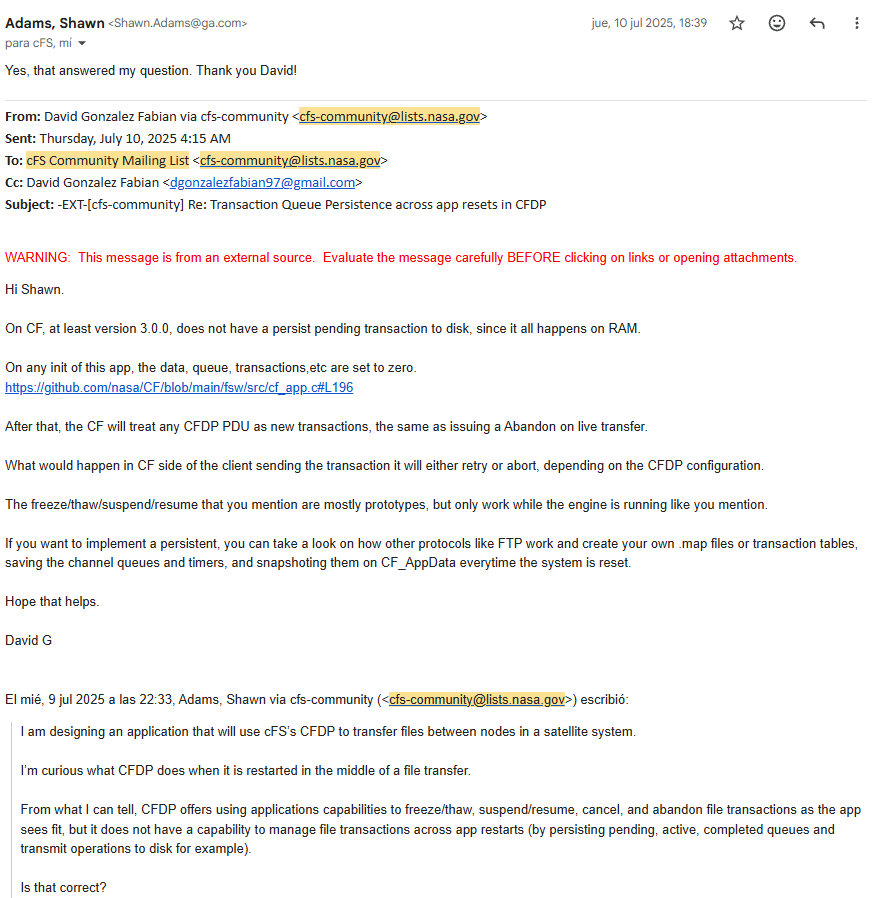

### 2.2 Core Framework — cFE

The reusable software core could also be provided by a commercial spacecraft SDK, including platforms from suppliers such as GomSpace, Space Inventor or Bright Ascension. These solutions may reduce integration effort when the software is closely coupled to the supplier's OBC, but they may also increase dependency on a particular vendor, hardware platform or workflow.

Two relevant open-source flight-software frameworks are NASA's core Flight System, or cFS, and JPL's F Prime.

Both provide reusable flight-software infrastructure, although they use different architectural models:

- F´ follows a component-based C++ architecture with typed ports and generated deployment topologies.
- cFS uses a layered architecture based on cFE, OSAL, PSP and mission applications communicating through the Software Bus.

https://digitalcommons.usu.edu/cgi/viewcontent.cgi?article=6013&context=smallsat

This paper compares the two of them.

For this architecture, I would select a **cFE-based core** rather than integrating the complete cFS bundle unchanged.

This choice is based on:

- Previous experience with parts of cFS and cFE. 
- The suitability of the Software Bus for modular flight software
- Clear separation between applications, operating system and hardware
- The ability to run applications on host and target platforms, which eases development a lot
- The option to select only the services required by the mission

- Existing user and developer community, which can help and provide info when needed, really OSS friendly

Training : https://github.com/cfs-tools/cfs-basecamp/wiki/

The public cFS bundle is a starting point and example integration, not a complete flight distribution. A systems/arquitect is still responsible for selecting, adapting and verifying the required components.

The selected cFE services, which I would include in any OBC are :

- **Executive Services**, or ES
- **Software Bus**, or SB
- **Event Services**, or EVS
- **Time Services**, or TIME
- **Table Services**, or TBL
- **File Services API**, or FS

Command Ingest and Telemetry Output are also implemented as applications connected to the Software Bus,.

This creates a small reusable core that can support future missions while avoiding unnecessary framework weight.

The cFE approach is not monolithic. Applications are independently scheduled, expose defined interfaces and communicate mainly through Software Bus messages. This is consistent with the cFE application model, which distinguishes reusable software-only applications from hardware-servicing applications and recommends using published interfaces rather than internal calls between applications.
