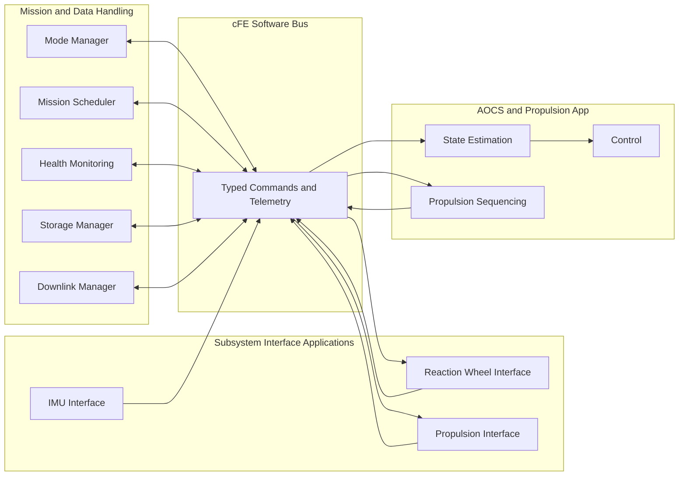

### 2.5 Application and Data Flow

An application does not need to know the implementation details of another application.

For example:

1. The AOCS Application publishes a reaction-wheel torque request.
2. The Reaction Wheel Interface subscribes to that message.
3. The interface converts the request into the wheel-specific command.
4. The command is transferred over the selected physical interface.
5. Reaction-wheel telemetry is decoded.
6. The interface publishes normalised telemetry on the Software Bus.
7. AOCS, Health Monitoring and Telemetry Output may subscribe to the same telemetry message.
