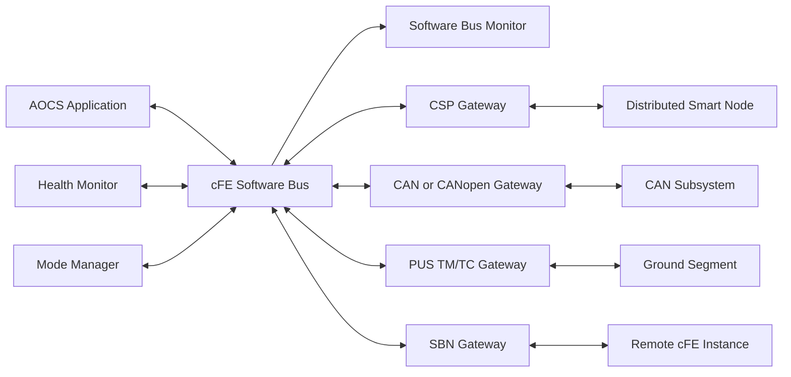

### 2.6 Software Bus and External Networks

Direct application-to-application function calls should be limited to tightly coupled library functions executing within the same application context.

Operational communication between independently scheduled applications should pass through the Software Bus.

This provides:

- Observable message flow
- Easier testing
- Independent application restart
- Reduced coupling
- Protocol independence
- Clear data ownership
- Easier addition of monitoring applications
- Easier replacement of subsystem implementations

The Software Bus is an internal software messaging mechanism. It is not itself a physical CAN, SpaceWire or Ethernet bus.

External communication requires a gateway or subsystem interface application:

If another processor or spacecraft node also uses cFE, NASA's Software Bus Network application is an example of bridging Software Bus traffic between separate cFS instances. 

If the remote node does not use cFE, a mission-specific CSP, CANopen, SpaceWire or serial gateway can provide the equivalent function.

Only the messages required by the external node should be forwarded. It is normally not appropriate to transmit all internal Software Bus traffic onto a constrained physical bus.

---
