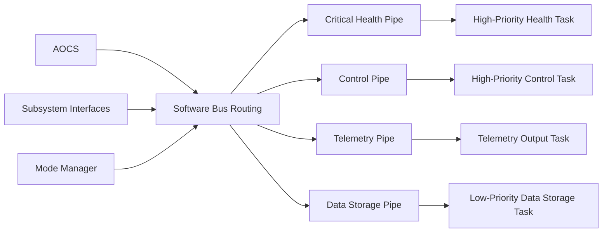

### 3.2 Software Bus

The Software Bus is the central internal communication mechanism.

Applications subscribe only to the message identifiers they require. This avoids direct dependencies between independently scheduled applications.

Representative message groups include:

- Spacecraft mode and requested transitions
- Time status and synchronisation quality
- Sensor measurements
- Sensor validity and age
- AOCS state
- Actuator commands
- Propulsion commands and telemetry
- Power-system telemetry
- Health events
- Ground commands
- Command-verification reports
- Payload status
- Storage status
- Update status

Messages may also be subscribed to by:

- Telemetry Output
- Data Storage
- Health Monitoring
- Diagnostic or AIT tools
- External gateways

This makes it possible to record or forward selected internal data without changing the application that produces it. NASA's Data Storage application is an existing example: it subscribes to Software Bus messages and stores selected messages in files for later transfer.

The Software Bus uses pipes with configured depths and per-message limits. 

A pipe overflow or message overrun is a local error on the affected pipe. It does not automatically block all other subscribers. The Software Bus reports the condition, and the consuming application and Health Monitor can include the counters in FDIR decisions.

The Software Bus should not be described as automatically prioritising one message inside a pipe over another. Messages in a cFE pipe are normally received in send order.

Critical traffic is prioritised through the architecture by using:

- Separate Software Bus pipes
- Separate consuming tasks
- Higher FreeRTOS task priority for critical consumers
- Smaller and bounded critical messages
- Rate limits on debug and bulk telemetry
- Separate communication queues for UHF and S-band
- Explicit drop or overwrite policies for non-critical data

For example, a Health Monitor should not share a long-running payload-processing loop. It should have its own pipe and a higher-priority task. This ensures that health events are processed quickly without depending on message reordering inside a single FIFO pipe.

A subsystem interface should also avoid blocking for many seconds while holding application resources.

