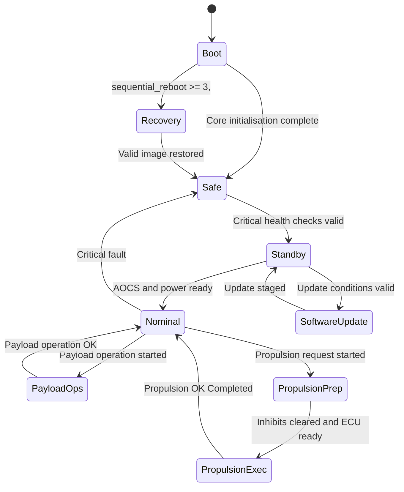

### 3.6 Mode Manager

The Mode Manager is the authoritative owner of the global spacecraft mode.

Representative modes are:

- Boot
- Recovery
- Safe
- Standby
- Nominal
- Payload Operations
- Propulsion Preparation
- Propulsion Execution
- Software Update

Only the Mode Manager authorises spacecraft-level transitions. 

Applications may:

- Request a transition
- Report a fault
- Report that a transition condition is satisfied
- Reject a requested operation because of local state

Applications cant change the global spacecraft mode.

The Mode Manager should remain a small and explicit state machine. It evaluates:

- Current mode
- Requested mode
- Health status
- Active faults
- Power and thermal conditions
- AOCS status
- Propulsion inhibits
- Communication requirements
- Transition-specific guards

Applications subscribe to the current-mode message and keep a local read-only copy. They do not need to implement every global mode internally. Each application defines which commands or behaviours are allowed in each relevant spacecraft mode.

This diagram is intentionally simplified and without the error pathz. The final transition table should also have specific conditions. 

This mode manager is easy to trace to requirements and statuses, and can be checked by systems and QA without any coding experience.
