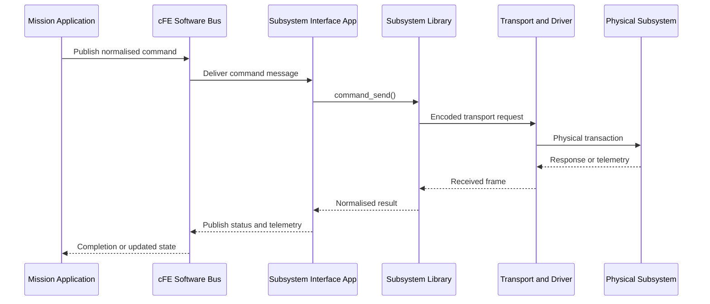

### 3.12 Driver-Independent Subsystem Library and Software Bus Integration

The driver-independent subsystem architecture includes the Software Bus explicitly.

 Mission applications communicate through normalised Software Bus messages. Hardware Interface Applications translate those messages into subsystem-library calls and publish normalised telemetry back onto the Software Bus.

The mission-facing subsystem API  :

```c
typedef enum {
    SUBSYSTEM_OK = 0,
    SUBSYSTEM_ERR_ARGUMENT,
    SUBSYSTEM_ERR_TIMEOUT,
} subsystem_status_t;

typedef struct {
    uint32_t timeout_ms;
    uint8_t retries;
    uint16_t node_id;
    void *transport_context;
} subsystem_context_t;

subsystem_status_t command_send(
    subsystem_context_t *context,
    const void *command,
    size_t command_size);

subsystem_status_t telemetry_read(
    subsystem_context_t *context,
    void *telemetry,
    size_t telemetry_size);

subsystem_status_t subsystem_get_status(
    subsystem_context_t *context,
    void *status);

subsystem_status_t subsystem_reset_link(
    subsystem_context_t *context);
```

A generic transport interface may be:

```c
typedef struct {
    int (*open)(void *context);
    int (*close)(void *context);

    int (*write)(
        void *context,
        const uint8_t *data,
        size_t length,
        uint32_t timeout_ms);

    int (*read)(
        void *context,
        uint8_t *data,
        size_t maximum_length,
        uint32_t timeout_ms);

    int (*reset)(void *context);
    int (*get_status)(void *context, void *status);
} transport_interface_t;
```

Possible platform backends are:

| Environment            | Backend example                                  |
| ---------------------- | ------------------------------------------------ |
| FreeRTOS               | BSP UART, SPI or CAN driver with queues and DMA  |
| CMSIS                  | `Driver_USART`, `Driver_CAN`, `Driver_SPI`       |
| Zephyr                 | UART, CAN, SPI device API, RTOS `but linux-like` |
| Linux                  | `/dev/ttyS0`, SocketCAN or sockets               |
| Host simulation        | Loopback, cmock or virtual device/ function      |
| Distributed spacecraft | CSP transport adapter                            |


The Subsystem Interface Application owns the Software Bus pipes and the asynchronous transaction state. It should not make a high-priority mission application block directly on a slow UART or remote transaction.

A representative command interaction is:




The cFE Software Bus allows other cFS applications, such as Health Monitoring, Data Storage and Telemetry Output, to observe the same normalised subsystem telemetry without coupling themselves to the device driver.


__________________________________
