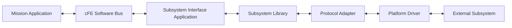

### 5.1 Subsystem communication

This architecture allows an implementation to use FreeRTOS drivers on the flight OBC and Linux device files or mocked transports during development without changing the mission application.

CSP/PUS is appropriate when a remote subsystem is an intelligent embedded node. It remains below the mission-facing subsystem API.
