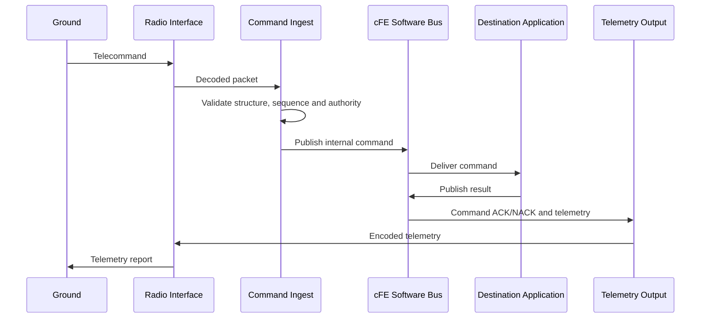

## 5. Communication Architecture

The communication architecture separates four concerns:

1. Ground TM/TC services
2. Internal OBC communication
3. Communication with distributed spacecraft nodes
4. Physical buses and radio links

The selected baseline is:

```text
Ground monitoring and control
→ PUS-compatible TM/TC

Communication between applications inside the OBC
→ cFE Software Bus

Communication with distributed smart nodes
→ CSP or a subsystem-specific protocol

Physical transport
→ CAN, UART, RS-422, SpaceWire or another selected interface
```

PUS is used as a mission-tailored service model. Only the services required by the mission need to be implemented. Typical functions include command verification, housekeeping, event reporting, scheduling, parameter management and file transfer.

The ground command path is:



Command Ingest validates common packet properties. The receiving application validates whether the requested action is allowed in its current state.

For example, the Propulsion Application and Mode Manager still verify:

- Inhibit status
- Active faults
- Power and thermal conditions
- Valid execution window (if command is outdated)

Then, there is some error at some points the Propulsion App may output the error status to the telemetry.

<!-- nav:start -->

- [5.1 Subsystem communication](01-subsystem-communication.md)
- [5.2 UHF and S-band](02-uhf-and-s-band.md)

<!-- nav:end -->
