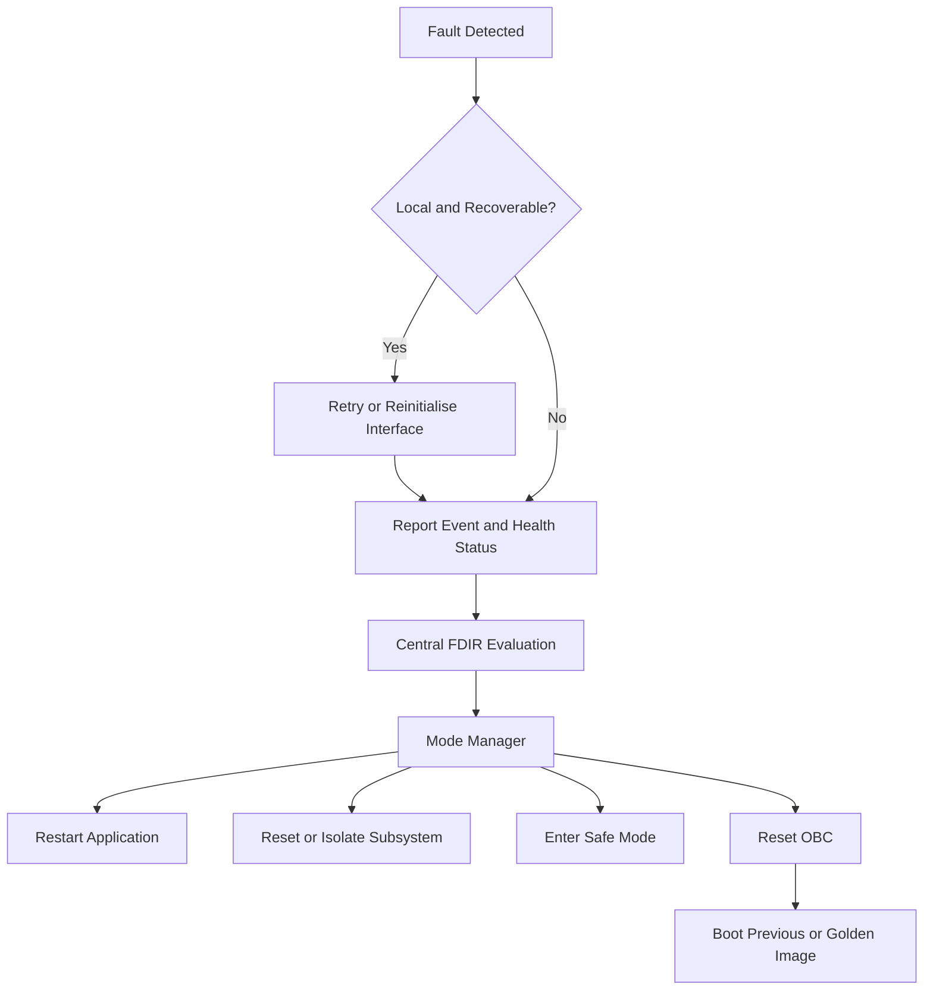

## 6. Fault Containment and Recovery

The selected FDIR architecture is hybrid, thats why it couldnt be written as a specific app, since it happens in every task, and the results of these tasks are sent upon a central task.

Applications and subsystem interfaces detect local failures because they understand their own data, state and timing requirements. Central Health Monitoring, FDIR and the Mode Manager coordinate recovery actions that affect the complete spacecraft. If, some of this local faults is minimal, (i.e some low priority hk corrupted), the HK app can handle it, and retry the operation without giving notice to the main FDIR app.

Local detection examples include:

- Missing or invalid sensor samples
- Communication timeout
- Protocol or CRC error
- Stale AOCS input
- AOCS deadline overrun
- Invalid propulsion-state transition
- Storage failure
- Queue overflow
- Application heartbeat failure
- Invalid update image

If needed, a central FDIR can be developed that evaluates.

- Severity
- Persistence
- Number of repetitions
- Current spacecraft mode
- Related active faults
- Previous recovery attempts
- Available recovery options

Local applications may perform bounded and reversible actions such as retrying a transaction or resetting a communication interface. Spacecraft-level actions are coordinated by the Mode Manager.

The cFS Health and Safety application can provide execution monitoring and watchdog servicing. Limit Checker can evaluate configured thresholds. These applications provide detection mechanisms; the mission-specific FDIR and Mode Manager still own the recovery policy.

Critical fault evidence should be stored in a protected circular log containing : 

- Reset reason
- Active software version
- Spacecraft mode
- Last critical events
- Task deadline status (and other FreeRTOS measurements)
- AOCS state
- Watchdog state
- Stack info (PC, REGS, WD, ) a core-dump

---
